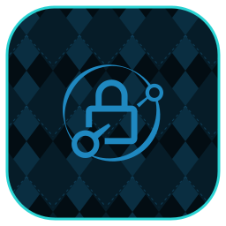

<p align="center">
  
</p>

# caddy

Caddy is a fast, automatic-HTTPS web server and reverse proxy.

A first-party [orca](https://github.com/argyle-labs/orca) plugin: first-class CRUD over an already-running Caddy instance's reverse-proxy routes (plus config read / reload / status) over its **admin API** — so you stop hand-editing the `Caddyfile`.

This repo is **self-contained** — the steps below run caddy **by hand, without orca**. orca then drives the running instance's routes through the tools below (and automates deploy/backup via the generic `service.*` surface).

---

## Run it without orca

### Docker Compose

```yaml
# compose.yml
services:
  caddy:
    image: caddy:latest
    container_name: caddy
    restart: unless-stopped
    ports:
      - "80:80/tcp"
      - "443:443/tcp"
      - "443:443/udp"   # HTTP/3
    volumes:
      - ./Caddyfile:/etc/caddy/Caddyfile
      - ./data:/data
      - ./config:/config
```

```sh
docker compose up -d
```

### Other runtimes

**Podman** — the compose above works with `podman compose up -d`, or run it directly:

```sh
podman run -d --name caddy --restart unless-stopped \
    -p 80:80/tcp \
    -p 443:443/tcp \
    -p 443:443/udp \
    -v ./Caddyfile:/etc/caddy/Caddyfile \
    -v ./data:/data \
    -v ./config:/config \
    caddy:latest
```

**LXC** — on a container-capable LXC (e.g. a Proxmox LXC with nesting enabled) run the same image via Docker/Podman as above, or install caddy from upstream directly on the guest: <https://caddyserver.com/>.

**VM** — install caddy from upstream (<https://caddyserver.com/>) or run the same container image inside the VM; expose port `80`.

**Unraid** — add via *Community Applications*, or *Docker → Add Container* with image `caddy:latest`, port `80`, and the volume paths above.

### Ports & data

| | |
|---|---|
| Default port | `80` |
| Upstream | <https://caddyserver.com/> |
| Operator notes | [caddy.md](docs/caddy.md) |


### Backup & restore

Back up the config/data volume(s) above — that's the whole service state (stop the container first for a clean copy). Restore by putting them back and starting it.

> With orca this is **`service.backup` / `service.restore`** — location-agnostic (docker / podman / lxc / vm), one command regardless of where caddy runs. No per-service backup script.

## With orca

A translation layer over Caddy's official [admin API](https://caddyserver.com/docs/api). Register a running instance as an endpoint whose `routes` point at the admin API (see [Reaching the admin API](#reaching-the-admin-api)), then drive it:

```sh
orca caddy.create --name edge --route lan=http://localhost:2019 --enabled true
orca caddy.status        --name edge
orca caddy.route.list    --name edge
orca caddy.route.set     --name edge --host orca.example.com --upstream 10.0.0.6:12000
orca caddy.route.set     --name edge --host app.example.com --upstream 10.0.0.9:8080,10.0.0.10:8080
orca caddy.route.delete  --name edge --host app.example.com
orca caddy.tls.ensure    --name edge --host cert-only.example.com
orca caddy.config.get    --name edge
orca caddy.config.export --name edge
orca caddy.config.persist --name edge
orca caddy.reload        --name edge
```

Writes run by default. When the call runs on the system that hosts the plugin, `dryRun=true` still reads the live config and returns the same report (actions, route index, TLS decision, and a `changes` list of JSON-pointer before/after values) without writing anything. orca currently refuses `dryRun` on a call addressed to another system's id unless the tool is execute-gated, and these writes are dry-run aware rather than execute-gated. With option 1 below, run dry runs on the Caddy host's orca directly. Reads need `read` and writes need `admin`.

Every write is planned from one `GET /config/` snapshot and applied as one `PATCH /config/apps` (or `/config/admin` for `config.persist`) carrying that snapshot's `Etag` as `If-Match`. If `GET /config/` returns no `Etag`, the write is refused rather than sent unguarded. If the config changed in between, Caddy answers HTTP 412 ([concurrent config changes](https://caddyserver.com/docs/api#concurrent-config-changes)), and the verb re-reads and re-plans, up to 3 attempts. Writes that change nothing are skipped. Every report warns when `admin.config.load` is set, because a config loader can replace admin-API changes ([`admin.config.load`](https://caddyserver.com/docs/json/admin/config/load/)).

| Tool | Role | Admin API |
|---|---|---|
| `caddy.list` / `caddy.detail` | read | orca endpoint registry |
| `caddy.create` / `caddy.update` / `caddy.delete` | admin | orca endpoint registry |
| `caddy.status` | read | `GET /config/`, `GET /reverse_proxy/upstreams` (failure reason in `upstreams_error`) |
| `caddy.config.get` | read | `GET /config/`, redacted |
| `caddy.config.export` | read | `GET /config/`, redacted, with the JSON pointer of each redacted value |
| `caddy.route.list` | read | `GET /config/` |
| `caddy.route.set` | admin | `GET /config/`, `PATCH /config/apps` |
| `caddy.route.delete` | admin | `GET /config/`, `PATCH /config/apps` |
| `caddy.tls.ensure` | admin | `GET /config/`, `PATCH /config/apps` |
| `caddy.config.persist` | admin | `GET /config/`, `PATCH /config/admin` |
| `caddy.reload` | admin | `GET /config/`, then `POST /config/` with the same body, `Cache-Control: must-revalidate` and `If-Match` |

API references: [`GET/PUT/PATCH /config/[path]`](https://caddyserver.com/docs/api#get-configpath), [`GET /reverse_proxy/upstreams`](https://caddyserver.com/docs/api#get-reverse-proxyupstreams), [TLS automation policies](https://caddyserver.com/docs/json/apps/tls/automation/policies/), [`apps.tls.certificates.automate`](https://caddyserver.com/docs/json/apps/tls/certificates/automate/), [`admin.config.persist`](https://caddyserver.com/docs/json/admin/config/persist/).

`api_key` is optional and stored as the orca secret `caddy.<endpoint>.api_key`. Caddy's admin API has no bearer auth of its own; the key is sent as `Authorization: Bearer` for an authenticating proxy in front of it.

### Redaction

No tool returns secrets. `caddy.config.get` and `caddy.config.export` replace with `<redacted>`:

- every secret-shaped key (orca's shared scrub list: `password`, `token`, `secret`, `api_key`, ...), plus `connection_string`, `*dsn` and `*uri` keys (the `*uri` rule also hides harmless values such as a `redirect_uri`);
- every value of `apps.tls.dns`, of a DNS challenge's `provider` (`issuers[*].challenges.dns.provider`) and of an ACME `external_account`, whatever its shape, keeping only a string `name` (or `key_id`). Of a DNS challenge's own settings only `ttl`, `resolvers`, `override_domain`, `propagation_delay` and `propagation_timeout` stay visible; any other key is redacted;
- in every whitespace-separated word of every string value:
  - in a URL (`scheme://...`), everything up to the last `@`, even when the `@` is in the path, so `postgres://u:pa/ss@db/x` becomes `postgres://<redacted>@db/x` and `https://example.com/a@b` over-redacts to `https://<redacted>@b`;
  - the value of every query parameter whose percent-decoded name is secret-shaped (`?token=...`, `api%5Fkey=...`) or is `signature`, `sig`, `credential`, `X-Amz-Signature`, `X-Amz-Credential` or `X-Amz-Security-Token`, with or without a scheme;
  - without a scheme, everything up to the last `@` when that part contains `:` (`user:pass@host:6379`). A bare `token@host` with no colon and no scheme is not recognised, because it cannot be told apart from an email address.

  This covers, for example, a storage `connection_string`, a redis `address` and the `admin.config.load` URL. `caddy.route.list` applies the same rule to dial addresses.

`caddy.config.export` also lists the JSON pointer of every redacted value. The export is for review and diffing, not restore. The restorable copy is Caddy's own `autosave.json`: `service.backup` covers it through the `/config` data path for the container image; a native install keeps it under the service user's home (`/var/lib/caddy/.config/caddy/` for the Debian package), which the backup must include.

### Hosts and upstreams

- Hosts are lowercased before writing. Labels are 1-63 characters of `a-z`, `0-9` and `-`, and do not start or end with `-`. Internationalized names must be given in punycode (`xn--...`).
- `*.example.com` is a [host matcher](https://caddyserver.com/docs/json/apps/http/servers/routes/match/host/) wildcard: it matches exactly one label (`a.example.com`, not `example.com` or `a.b.example.com`). The same rule decides TLS subject coverage.
- Upstreams are `host:port`, `[ipv6]:port` or `unix//path`. Placeholders and URLs are refused.
- As a safety rail against mistakes, not an authorization boundary, the plugin refuses to point a route at this Caddy's admin API (any `127.0.0.0/8`, `::1` or IPv4-mapped loopback address counts as `localhost`) (`admin.listen`, default `localhost:2019`, or the endpoint's own address). It also refuses to change or delete the route for the hostname the endpoint reaches the admin API through, so orca cannot cut off its own access.

### Routes

A route counts as a host's route only when every matcher set in it is exactly `{"host": [...]}` and lists the host.

- `caddy.route.set` replaces the upstreams of that route's single `reverse_proxy`, including one inside a Caddyfile-style `subroute`. It writes nothing when they already match.
- It refuses, and writes nothing (TLS included), when the host's route:
  - also has path, method, header or other conditions;
  - also serves other hosts;
  - has more than one `reverse_proxy`, or none;
  - is one of several routes for the host;
  - is matched inside a subroute, for example a `@name host ...` matcher in a wildcard site block.
- A new host gets `{"match":[{"host":[host]}],"handle":[{"handler":"reverse_proxy",...}],"terminal":true}`. It is inserted before the first route that could match the host. That is deliberately conservative: a route without matchers, a matcher set without a `host` condition (even one restricted by path), or a host pattern matching the host all count, so the new route may land earlier than strictly needed, but never behind a route that would catch it.
- `caddy.route.delete` removes a route that serves only that host. From a route shared with other hosts it removes just the host, and drops a matcher set whose host list becomes empty instead of leaving a broader matcher.
- `caddy.route.list` reports hosts matched inside subroutes with `nested: true`.

### TLS

Caddy uses the first [automation policy](https://caddyserver.com/docs/json/apps/tls/automation/policies/) whose `subjects` match a name; a policy without `subjects` matches every name. For the host, `caddy.route.set` (and `caddy.tls.ensure`):

1. Reports the covering policy and its challenge type (`dns01`, `http_or_tls_alpn` or `internal`), with a warning when it is not DNS-01.
2. Otherwise adds the host to the `subjects` of a DNS-01 policy (an issuer with `challenges.dns`) whose subjects share at least the last two labels with it, preferring the longest shared suffix. orca has no public-suffix list, so under multi-label public suffixes such as `co.uk` two unrelated domains can qualify.
3. Otherwise writes nothing and warns: Caddy's default issuers (HTTP-01 / TLS-ALPN-01) apply, which need the host to be publicly reachable.

A route's host gets a certificate through automatic HTTPS. `caddy.tls.ensure` is for a host with no route: after the steps above it also adds the host to `apps.tls.certificates.automate` so Caddy obtains and renews the certificate anyway. Certificates loaded from files are not considered.

### Running from JSON so admin-API changes survive restarts

Admin-API changes apply live, and Caddy autosaves the active config to `autosave.json` in its [config directory](https://caddyserver.com/docs/conventions#configuration-directory) (`admin.config.persist`, default `true`). A Caddy started with `--config Caddyfile` ignores that file and reloads the Caddyfile on every restart or `caddy reload`, discarding everything orca wrote. Convert once, on the Caddy host (systemd, Debian package):

```sh
# 1. Back up, then render the Caddyfile to JSON and check it.
cp -a /etc/caddy/Caddyfile /etc/caddy/Caddyfile.pre-json
caddy adapt --config /etc/caddy/Caddyfile --pretty > /etc/caddy/caddy.json
caddy validate --config /etc/caddy/caddy.json

# 2. Load it through the admin API, then confirm the autosave exists and matches.
curl -fsS -X POST -H 'Content-Type: application/json' \
  --data-binary @/etc/caddy/caddy.json http://localhost:2019/load
AUTOSAVE=/var/lib/caddy/.config/caddy/autosave.json
test -s "$AUTOSAVE" && caddy validate --config "$AUTOSAVE"

# 3. Run from the autosave, without --environ.
systemctl edit caddy-api
#   [Service]
#   EnvironmentFile=/etc/caddy/caddy.env
#   ExecStart=
#   ExecStart=/usr/bin/caddy run --resume
systemctl disable --now caddy
systemctl enable --now caddy-api
curl -fsS http://localhost:2019/config/ >/dev/null && orca caddy.status --name <endpoint>
```

- **Rollback:** `systemctl disable --now caddy-api && systemctl enable --now caddy` brings back the Caddyfile service from `/etc/caddy/Caddyfile` (unchanged; the copy is `Caddyfile.pre-json`). Anything orca wrote since the switch is then gone; record it first with `orca caddy.route.list` if you need to re-apply it.
- [`caddy adapt`](https://caddyserver.com/docs/command-line#caddy-adapt) and [`caddy validate`](https://caddyserver.com/docs/command-line#caddy-validate) do not touch the running server. [`caddy run --resume`](https://caddyserver.com/docs/command-line#caddy-run) starts from the last autosave. The packaged `caddy-api` unit is described in [Linux service](https://caddyserver.com/docs/running#linux-service).
- The `ExecStart` override drops `--environ`, which prints the whole environment (including `CF_API_TOKEN`) to the journal at startup. Placeholders such as `{env.CF_API_TOKEN}` survive `adapt` and still resolve from the `EnvironmentFile` (mode `0600`, owned by root).
- The autosave path follows the service user's home; check it with `systemctl show caddy-api -p User` and `caddy environ` run as that user.
- **Docker:** set the container command to `caddy run --resume`, keep `/config` (which holds `caddy/autosave.json`) and `/data` on volumes, and pass `CF_API_TOKEN` through `environment:`/an env file. Seed it once with the same `caddy adapt` + `POST /load`, and check `docker exec caddy test -s /config/caddy/autosave.json` before relying on restarts. Rollback is restoring the previous command and Caddyfile mount.
- After the switch, do not run `caddy reload --config Caddyfile`. `caddy.config.persist` turns `admin.config.persist` back on if it was set to `false`.

### Reaching the admin API

The admin endpoint listens on `localhost:2019` by default. Anyone who can reach it can rewrite the server, so it must not be opened to the network without access control ([admin](https://caddyserver.com/docs/json/admin/)).

The plugin's HTTP requests are executed by the orca daemon that runs the plugin process, through its `http.request` capability. They go out from that daemon's host, not from wherever the CLI or MCP client is. A route of `http://localhost:2019` therefore means "the Caddy on the host where this tool call runs".

1. **An orca member on the Caddy host (recommended).** Install orca and the caddy plugin on the Caddy host (CT104), register the endpoint there with `--route lan=http://localhost:2019`, and address every `caddy.*` call to that system's id so orca dispatches it to that member. The admin API stays loopback-only, and needs no new listener or credential. Called on any other system (for example the hub), the same endpoint would talk to that system's own loopback, so never register a `localhost` route on a system that is not the Caddy host.
2. **Loopback admin behind an authenticating HTTPS site.** Keep `admin localhost:2019` and add a LAN-only `https://caddy-admin.<domain>` site that requires the Hydra forward-auth or a bearer token and `reverse_proxy`s to `localhost:2019` with `header_up Host localhost:2019`. Without that header, the admin endpoint's Host/Origin check rejects the request. Register `--route lan=https://caddy-admin.<domain>` and store the token as `caddy.<endpoint>.api_key`. The plugin refuses to change that site's route, but a hand edit or a `POST /load` can still cut off access.
3. **`admin.listen` on a LAN address with `origins`.** Avoid. [`origins` / `enforce_origin`](https://caddyserver.com/docs/json/admin/origins/) protect against DNS rebinding and are not authentication: every host on the LAN gets full control.
4. **Remote admin (`admin.remote`).** Authenticates clients by mTLS public key with per-path permissions ([remote](https://caddyserver.com/docs/json/admin/remote/)). It needs a client certificate on every request, and the plugin's delegated HTTP sends none.

## Layout

- `src/lib.rs` — the `ServiceBackend` and the `#[endpoint_resource]` registry.
- `src/api.rs` — the admin-API client.
- `src/routes.rs` — route list/upsert/delete over the config JSON.
- `src/tls.rs` — automation-policy coverage, the subject to add, and the change records.
- `src/redact.rs` — config redaction.
- `src/tools.rs` — the `caddy.*` tools.
- `src/main.rs` — the `Plugin` builder entrypoint (dual facet: service + tools).
- `docs/` — standalone operator notes.
- [CAPABILITIES.md](CAPABILITIES.md) — the plugin contract checklist.
- `assets/` — plugin icon.
